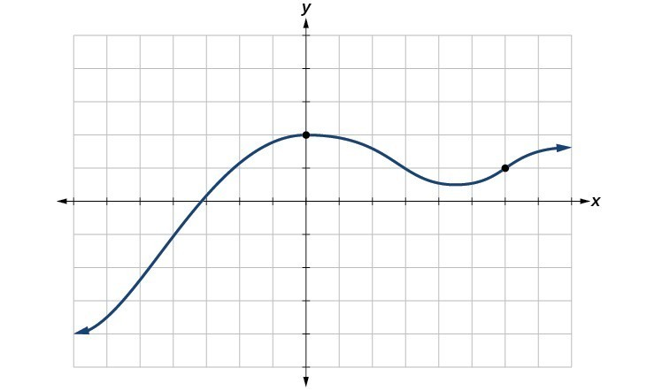
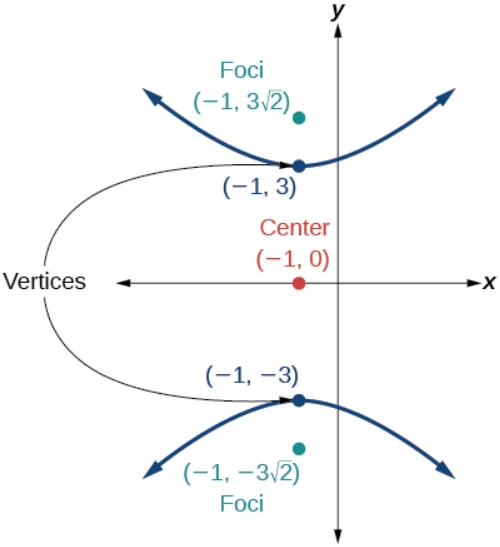

# AVP1886 — Single visual target

MathVista:686 / MathVerse:437 · different type · Mathematical roles of symbols

## Shared or similar visual information

The lowercase letter x.

## Evidence locations

- Left image: x at the right end of the horizontal axis through the smooth graph.
- Right image: x at the right arrow of the axis passing through the hyperbola center.

## Mathematical meanings

Left image: x names the horizontal coordinate axis (the right end of the horizontal axis through the smooth graph). Right image: x names the horizontal coordinate axis (the right arrow of the axis passing through the hyperbola center).

## Same mathematical meanings

yes

## Rationales

In both images, x names the horizontal coordinate axis. The relevant locations are the right end of the horizontal axis through the smooth graph on the left and the right arrow of the axis passing through the hyperbola center on the right.

Only the selected target is annotated. AI visual-review draft; not independently double-annotated by humans.
