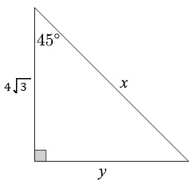
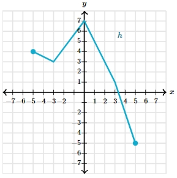

# AVP1891 — Single visual target

MathVerse:375 / MathVerse:558 · different type · Mathematical roles of symbols

## Shared or similar visual information

The lowercase letter x.

## Evidence locations

- Left image: x at the label beside the hypotenuse.
- Right image: x at the right tip of the horizontal axis under graph h.

## Mathematical meanings

Left image: x gives an unknown length (the label beside the hypotenuse). Right image: x names the horizontal coordinate axis (the right tip of the horizontal axis under graph h).

## Same mathematical meanings

no

## Rationales

On the left, x represents an unknown length (the label beside the hypotenuse). On the right, x names the horizontal coordinate axis (the right tip of the horizontal axis under graph h).

Only the selected target is annotated. AI visual-review draft; not independently double-annotated by humans.
