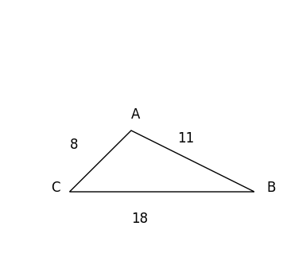
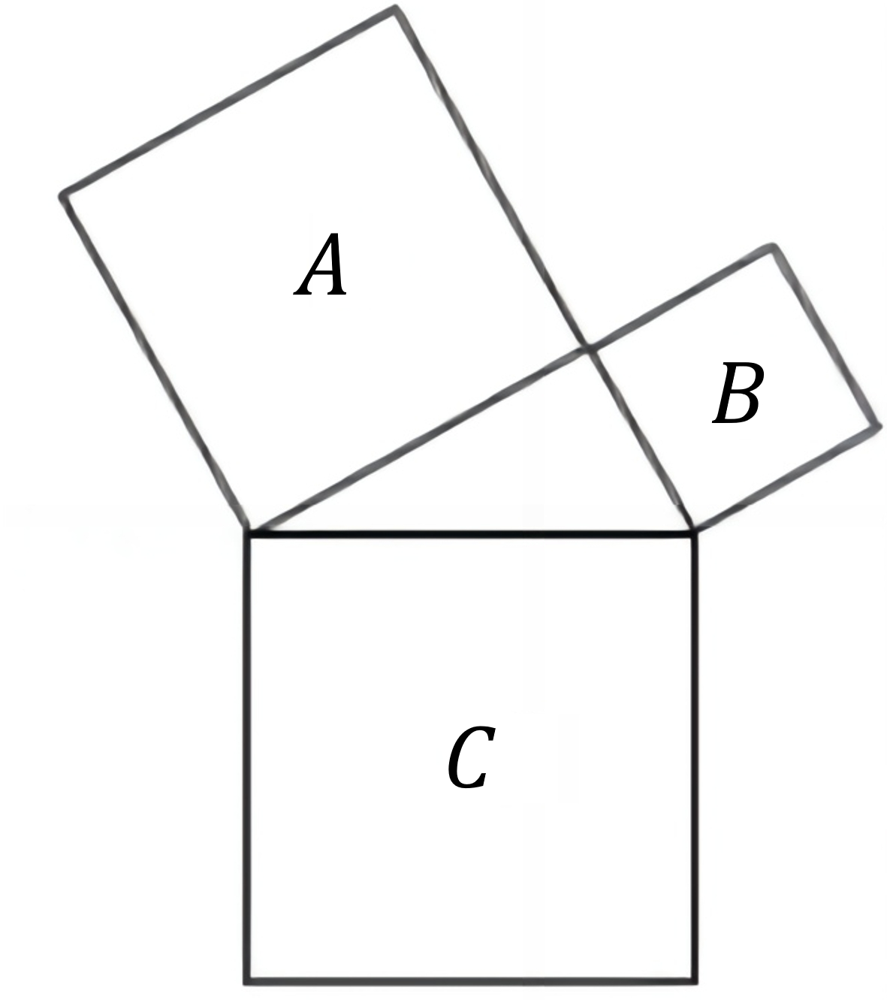

# AVP1893 — Single visual target

DynaMath:206 / DynaMath:85 · same type · Mathematical roles of symbols

## Shared or similar visual information

The uppercase letter A.

## Evidence locations

- Left image: A at the apex between the sides labeled 8 and 11.
- Right image: A at the label inside the large tilted square.

## Mathematical meanings

Left image: A names a specific point in the diagram (the apex between the sides labeled 8 and 11). Right image: A identifies a square region (the label inside the large tilted square).

## Same mathematical meanings

no

## Rationales

On the left, A names a specific point in the diagram (the apex between the sides labeled 8 and 11). On the right, A identifies a square region (the label inside the large tilted square).

Only the selected target is annotated. AI visual-review draft; not independently double-annotated by humans.
