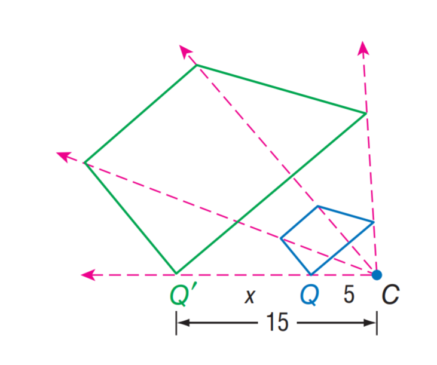
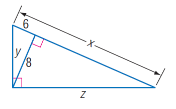

# AVP1894 — Single visual target

MathVista:206 / MathVista:310 · same type · Mathematical roles of symbols

## Shared or similar visual information

The lowercase letter x.

## Evidence locations

- Left image: x at the label beneath the segment from Q′ to Q.
- Right image: x at the label on the dimension arrow spanning the slanted side.

## Mathematical meanings

Left image: x gives an unknown length (the label beneath the segment from Q′ to Q). Right image: x gives an unknown length (the label on the dimension arrow spanning the slanted side).

## Same mathematical meanings

yes

## Rationales

In both images, x represents an unknown length. The relevant locations are the label beneath the segment from Q′ to Q on the left and the label on the dimension arrow spanning the slanted side on the right.

Only the selected target is annotated. AI visual-review draft; not independently double-annotated by humans.
