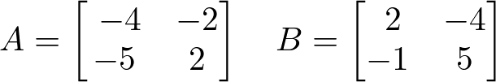
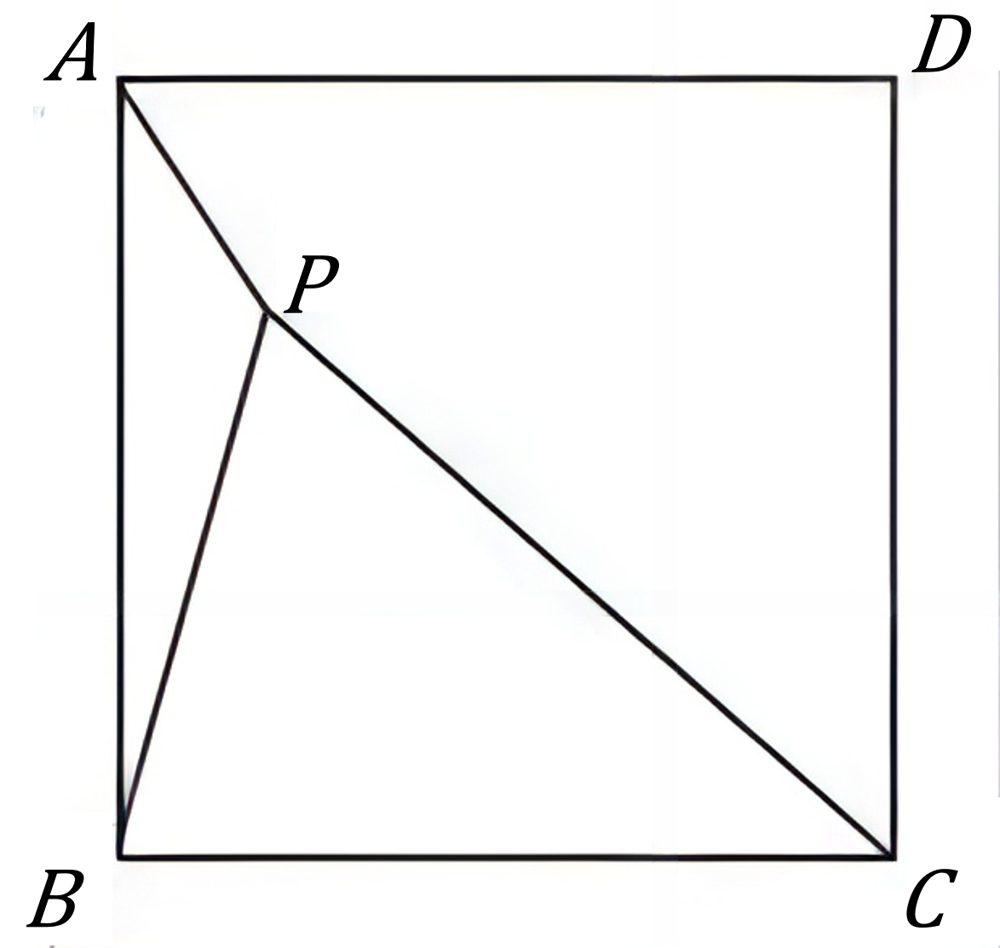

# AVP1895 — Single visual target

DynaMath:488 / DynaMath:145 · different type · Mathematical roles of symbols

## Shared or similar visual information

The uppercase letter B.

## Evidence locations

- Left image: B at the letter before the right bracketed array.
- Right image: B at the lower-left vertex of the square.

## Mathematical meanings

Left image: B names the matrix printed after the equals sign (the letter before the right bracketed array). Right image: B names a specific point in the diagram (the lower-left vertex of the square).

## Same mathematical meanings

no

## Rationales

On the left, B names the matrix printed after the equals sign (the letter before the right bracketed array). On the right, B names a specific point in the diagram (the lower-left vertex of the square).

Only the selected target is annotated. AI visual-review draft; not independently double-annotated by humans.
