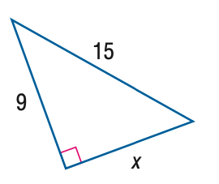
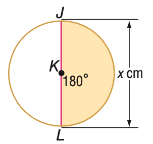

# AVP1900 — Single visual target

MathVista:160 / MathVista:250 · same type · Mathematical roles of symbols

## Shared or similar visual information

The lowercase letter x.

## Evidence locations

- Left image: x at the label beside the lower leg of the right triangle.
- Right image: x at the label x cm beside the vertical diameter dimension arrow.

## Mathematical meanings

Left image: x gives an unknown length (the label beside the lower leg of the right triangle). Right image: x gives an unknown length (the label x cm beside the vertical diameter dimension arrow).

## Same mathematical meanings

yes

## Rationales

In both images, x represents an unknown length. The relevant locations are the label beside the lower leg of the right triangle on the left and the label x cm beside the vertical diameter dimension arrow on the right.

Only the selected target is annotated. AI visual-review draft; not independently double-annotated by humans.
